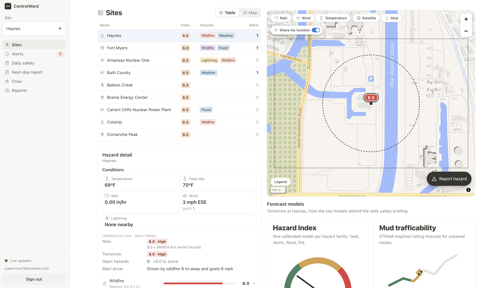
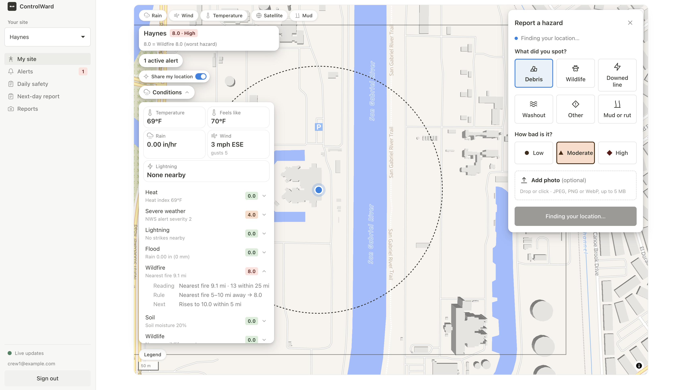
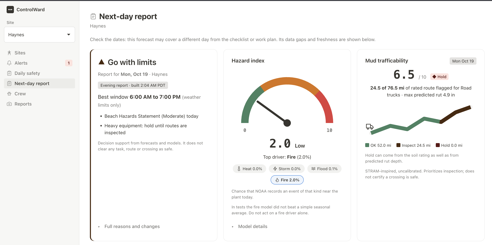
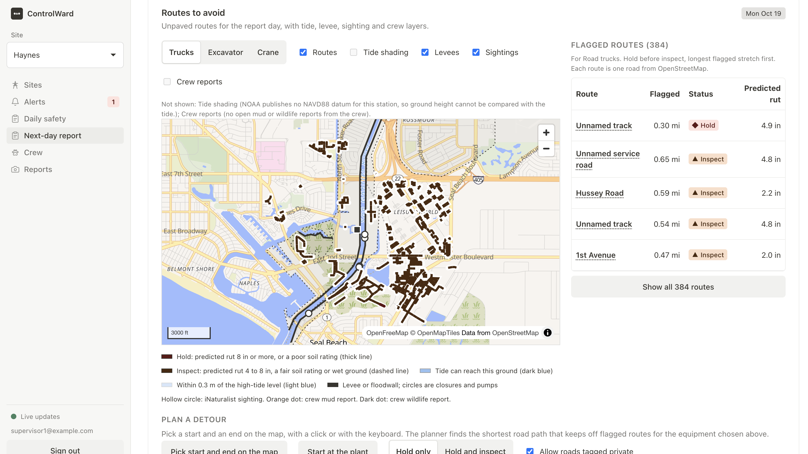
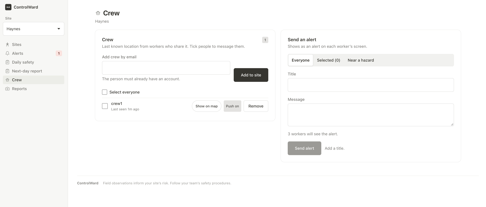

# ControlWard

**Perform your site's due diligence all in one place, across 18 data sources spanning weather, severe events, human safety, wildlife welfare, and policy adherence: a Control Ward. Across 60 real power plants, fed by live weather, heat, lightning, flood, wildfire, and soil data, plus crew photos pinned to the map and an ML hazard forecast trained on years of storm and injury history.**

[Run it](#run-it) · [What it looks like](#what-it-looks-like) · [Architecture](#architecture)


<sub>Rank the fleet, see why the top site is risky, report a hazard from the field, alert the crew, and wake up to a verdict.</sub>

Scores run 0 to 10, 7+ is High, 4+ is Elevated, the rest is Low. We always show the number and label, not just color.

## The problem

Utility crews mobilize at 6:45 AM in the Everglades in August. By noon the heat index passes 110. Afternoon storms build to the west, a week of rain has trucks stuck in the muck, and the gator by the swamp lives in one person's texts. Every one of those hazards is knowable ahead of time.

The data is public but scattered across a dozen apps and agencies: Open-Meteo and NWS for weather and heat, lightning and NIFC for fire, USGS gauges and NOAA tides for water, USACE for levees, EIA-860M for plant locations, OSHA for what hurt people before. At the Sperry tech talk, that fragmentation was the throughline: every hazard has an owner and a feed, but nobody turns it into a decision, so go or no go gets called on instinct the morning of.

ControlWard builds that screen. It gives a supervisor a rank worth checking tonight for tomorrow. It does not clear a site or promise safety.

## What it looks like

The Sites view is the ranking. Open Sites, pick the highest risk plant, open its alerts, then flip to the Next-day verdict. Every caption below is built from stored data.

<table>
<tr>
<td width="50%"></td>
<td width="50%"></td>
</tr>
<tr>
<td><b>Rank the fleet.</b> Haynes sits first at 8.0 High with Wildfire plus Weather and 1 alert. Fort Myers follows at 6.6 with Wildlife plus Flood. Arkansas Nuclear One sits at 6.5 with Lightning plus Wildfire. The map pins the pick and the detail names the driver.</td>
<td><b>Report it in seconds.</b> Just as a driver taps to report debris, a crew member picks Debris, Wildlife, Downed line, Washout, Other, or Mud or rut, sets Low, Moderate, or High, drops a photo up to 5 MB, and pins it to the site map. It alerts the team and feeds back into the score.</td>
</tr>
<tr>
<td></td>
<td></td>
</tr>
<tr>
<td><b>Wake up to a verdict.</b> Haynes for Mon Oct 19 reads Go with limits with a best window of 6:00 AM to 7:00 PM. Hazard index is 2.0 Low driven by Fire at 2.0 percent. Mud trafficability is 6.5 Hold with 24.5 of 76.5 mi flagged and max predicted rut 4.9 in. It does not clear any task as safe.</td>
<td><b>Routes to avoid.</b> 384 flagged routes around Haynes, longest Hold first. Unnamed track at 0.30 mi reads Hold with 4.9 in rut, Hussey Road reads Inspect with 2.2 in. Levees, sightings, and tide layers sit on the map and the detour planner keeps trucks off flagged roads.</td>
</tr>
</table>

<p align="center"></p>

The roster shows last known location for workers who share it. The composer targets Everyone, Selected, or Near a hazard and tells you 3 workers will see the alert before you hit Send alert.

That path covers the brief: 60 real EIA-860M plants in one score per site, lightning stop work inside 10 miles with a 30 minute restart, flood from overnight rain plus gauges plus NWS alerts, a 6 PM local briefing per site, crew photos pinned to the map that feed risk, a ranked map and table, and a 0 to 10 hazard index trained on NOAA Storm Events weighted by OSHA severity (174,895 rows, `hazidx-0.1.0+2018-2022.23ed6848`).

## Architecture

```text
 Live agency feeds (HTTPS JSON, pg_cron every 5 to 15 min) + crew input
      │
      ├─► Open-Meteo forecast, heat, rain ────────────────────────────────┐
      ├─► NWS alerts + lightning + NIFC fire ─────────────────────────────┤
      ├─► USGS gauges + NOAA tides + USACE levees + EIA-860M ─────────────┼─► Edge Functions (ingest + refresh)
      │   plants + OSHA history (nightly refresh)                         │   (the only live writer)
      └─► Crew photos + pins, via app ────────────────────────────────────┘
                                                                          │
 Trained models + safety checks                                           │
      ├─► hazard-index hazidx-0.1.0 (scikit-learn, 174k rows) ────────────┤─► upsert_ml_scores RPC
      ├─► mud-trafficability (SSURGO soils, uncalibrated) ────────────────┤─► soil flags
      └─► CodeAct worker + Gemini ────────────────────────────────────────┤─► versioned checklist
                                                                          ▼
                                              Supabase Postgres + PostGIS: readings, alerts,
                                              stored risk, crew reports, briefing drafts
                                                                          │ read-only
                                                                          ▼
                                              Realtime + Auth + Storage ─► React 19 + Vite +
                                              live sync, logins, photos      MapLibre app: Sites ranking,
                                                                             alerts + report, 6 PM briefing
```

- **Web:** React 19, TypeScript, Vite, and MapLibre GL 6, with live site views subscribed to Supabase Realtime, so alerts and risk update without a refresh.
- **Data:** Python 3.12 with scikit-learn for the trained models, TypeScript Edge Functions for ingest and briefings, and `reports/next-day` for the next-day generator.
- **Database:** Supabase Postgres with PostGIS. Risk, alerts, readings, crew reports, and briefing drafts live in versioned tables and views. The app only reads stored values, and missing or stale inputs show as gaps. A checklist only goes live after supervisor review.
- **AI:** Gemini through a Docker CodeAct worker for the safety checklist and plan. Every run fetches its own sources, validates citations against what it was given, and publishes through `generate-briefing-draft` plus review.

## Run it

**Web app** (Node 22):

```sh
npm ci
cp .env.example .env.local
npm run dev
```

That second step just fills in `VITE_SUPABASE_URL` and `VITE_SUPABASE_ANON_KEY`. Open `http://127.0.0.1:5173`, then follow Sites to alerts to the Next-day verdict.

Design mode needs no backend and is labeled as sample data on every page: `npm run dev:design`. Production never falls back to it. To read real data, set the hosted URL plus anon key plus a demo login and leave design mode off. If the database cannot be reached, the app says so instead of showing fixtures.

**Isolated stack plus agent** (Docker, Supabase CLI):

```sh
npm run safety:local:start
```

That starts a local DB plus the real CodeAct worker (see [docs/local-development.md](docs/local-development.md)). Live Gemini calls need your own key and they may incur charges.

**Models** (Python 3.12):

Hazard Index how to is `models/hazard-index/README.md`. Mud how to is `models/mud-trafficability/RUNBOOK.md`. Nothing writes to the database except an explicit push, which asks you to type the project ref.

**Checks:**

```sh
CHECK_EMAIL=... CHECK_PASSWORD=... npm run check:connection
npm run verify:monitoring
npm run verify:rules
npm run verify:crew-assignment
npm run build
```

The verify scripts are `tests/monitoring.verify.sql`, `tests/rules.verify.sql`, and `tests/crew-assignment.verify.sql`. They have to pass before you demo from hosted data.

## Repository

- `src/` is the React app (sites ranking, map, crew reporting, briefings)
- `supabase/` is the backend (migrations, Edge Functions, rules, schedules)
- `models/` holds the trained ML (hazard index plus mud-trafficability)
- `reports/` and `public/reports/` hold the next-day generator and sample outputs
- `docs/` is setup, contracts, and briefs
- `tests/` is backend, frontend, and verify scripts


## References

- Jones, Marie F. and Paul Alexander Arp. “Soil Trafficability Forecasting.” Open Journal of Forestry (2019): n. pag.
- U.S. Energy Information Administration. (n.d.). Preliminary monthly electric generator inventory (based on Form EIA-860M as a supplement to Form EIA-860) [Data set]. Retrieved October 18, 2026, from 
https://www.eia.gov/electricity/data/eia860m/
- National Oceanic and Atmospheric Administration, National Centers for Environmental Information. (n.d.). Storm Events Database [Data set]. Retrieved October 18, 2026, from 
https://www.ncei.noaa.gov/stormevents/
- Iowa State University, Department of Agronomy. (n.d.). Iowa Environmental Mesonet [Data portal]. Retrieved October 18, 2026, from 
https://mesonet.agron.iastate.edu/
- Occupational Safety and Health Administration. (n.d.). Severe injury reports [Data set]. U.S. Department of Labor. Retrieved October 18, 2026, from https://www.osha.gov/severe-injury-reports
- U.S. Army Corps of Engineers. (n.d.). National Levee Database [Geospatial database]. Retrieved October 18, 2026, from 
https://levees.sec.usace.army.mil/
- National Oceanic and Atmospheric Administration, Center for Operational Oceanographic Products and Services. (n.d.). Tides & currents [Data portal]. Retrieved October 18, 2026, from https://tidesandcurrents.noaa.gov/
- Federal Emergency Management Agency. (n.d.). FEMA Flood Map Service Center [Geospatial data portal]. U.S. Department of Homeland Security. Retrieved October 18, 2026, from https://msc.fema.gov/portal/home
